# Stop Procrastination with Claude

[](https://github.com/denysfreiuk/stop-procrastination-with-claude/actions/workflows/ci.yml)
[](LICENSE)

Система щоденного трекінгу навчання і звичок, у якій запис займає секунди, а не хвилини.

- **Telegram-бот** — пишеш з телефона: блок фокусу, нові слова, сон, зал, зрив на тікток.
- **Obsidian** — усе автоматично лягає в щоденник, а Dashboard рахує стріки й статистику.
- **Claude Code** — підсумок дня, тижневий огляд із закономірностями і картки Anki зі щоденника.

Усе працює на твоєму комп'ютері, а нотатки лишаються у тебе. Клонуєш репозиторій, запускаєш одну команду, відповідаєш на шість запитань — і система готова.

<p align="center">
  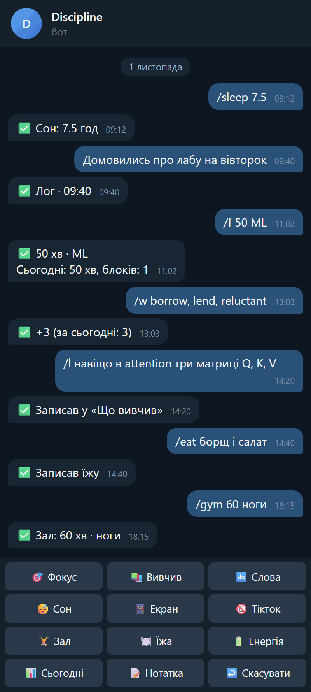
  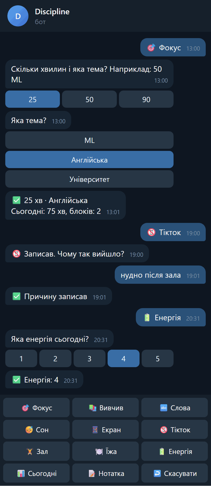
  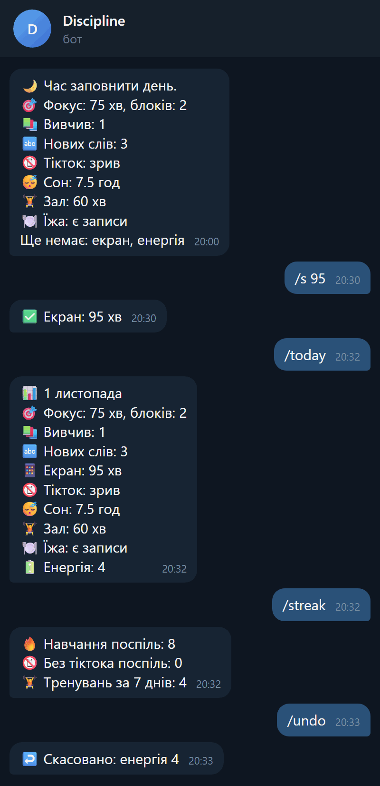
</p>

> Усі зображення в цьому README зроблені на вигаданих даних. Текст і числа справжні: їх видав код системи на демо-щоденнику. Вікна Telegram, Obsidian і термінала намальовані поверх цих результатів, це не знімки екрана самих застосунків.

## Зміст

**[Частина 1. Як цим користуватися](#частина-1-як-цим-користуватися)**

- [1.1 Що вміє система](#11-що-вміє-система)
- [1.2 Один день із системою](#12-один-день-із-системою)
- [1.3 Що потрібно перед встановленням](#13-що-потрібно-перед-встановленням)
- [1.4 Встановлення з нуля](#14-встановлення-з-нуля)
- [1.5 Telegram-бот](#15-telegram-бот)
- [1.6 Щоденник в Obsidian](#16-щоденник-в-obsidian)
- [1.7 Команди Claude Code](#17-команди-claude-code)
- [1.8 Картки Anki](#18-картки-anki)
- [1.9 Налаштування](#19-налаштування)
- [1.10 Оновлення і видалення](#110-оновлення-і-видалення)
- [1.11 Що буде, якщо комп'ютер вимкнений](#111-що-буде-якщо-компютер-вимкнений)
- [1.12 Типові проблеми](#112-типові-проблеми)
- [1.13 Приватність і резервні копії](#113-приватність-і-резервні-копії)

**[Частина 2. Як це влаштовано](#частина-2-як-це-влаштовано)**

- [2.1 Архітектура](#21-архітектура)
- [2.2 Структура репозиторію](#22-структура-репозиторію)
- [2.3 Єдиний конфіг](#23-єдиний-конфіг)
- [2.4 Бот зсередини](#24-бот-зсередини)
- [2.5 Плагін Claude Code](#25-плагін-claude-code)
- [2.6 Шаблон vault і статистика](#26-шаблон-vault-і-статистика)
- [2.7 Setup і автозапуск](#27-setup-і-автозапуск)
- [2.8 Захист приватності в git](#28-захист-приватності-в-git)
- [2.9 Тести і CI](#29-тести-і-ci)
- [2.10 Рішення і чому саме так](#210-рішення-і-чому-саме-так)
- [2.11 Як розвивати проєкт](#211-як-розвивати-проєкт)

**[Статус платформ](#статус-платформ)** · **[Плани](#плани)** · **[Ліцензія](#ліцензія)**

---

# Частина 1. Як цим користуватися

## 1.1 Що вміє система

| Частина | Що робить | Чи потрібен Claude |
|---|---|---|
| Telegram-бот | приймає записи з телефона, пише їх у щоденник, рахує день і стріки, нагадує ввечері | ні |
| Obsidian | зберігає щоденник, показує Dashboard зі статистикою за 7 і 30 днів | ні |
| `/journal` | короткий підсумок дня і 1 порада на завтра | так |
| `/weekly` | тижневий огляд: метрики, закономірності, 1–3 зміни | так |
| `/anki-from-notes` | картки Anki з того, що ти вивчив і яких слів нахапався | так |
| Плагін Anki | ще 9 команд для карток із будь-чого: текст, PDF, код, слова | так |

Головна ідея: записувати має бути настільки швидко, щоб лінь не перемогла. Тому щоденник заповнюється сам із коротких повідомлень у Telegram, а думати над ним ти починаєш лише тоді, коли запускаєш підсумок.

Бот і Obsidian працюють без Claude Code: якщо потрібен лише щоденник зі статистикою, цього достатньо.

**Що система збирає:** блоки фокусу, що вивчив, нові англійські слова, час екрана, зриви на тікток із причиною, сон, зал, харчування, енергію дня, вільні нотатки.

## 1.2 Один день із системою

**Зранку.** Прокинувся і надіслав боту `/sleep 7.5`. Сьогоднішня нотатка створилась сама з шаблону.

**Протягом дня.** Після кожного блоку навчання натискаєш **🎯 Фокус → 50 → ML**. Два натискання, і в нотатці є рядок із часом, а лічильники хвилин і блоків виросли. Дізнався щось нове: `/l як працює attention`. Зустрів слово: `/w reluctant`. Будь-яка думка без команди просто йде в лог дня.

**Сталось щось погане.** Зайшов у тікток: натиснув **📵 Тікток**, бот спитав чому, ти відповів «нудно після зала». Це потім побачить тижневий огляд.

**Увечері.** О 20:00 бот пише, що вже записано і чого бракує: «Ще немає: екран, енергія». Закриваєш прогалини двома повідомленнями.

**Коли є час сісти за комп'ютер.** Запускаєш `/journal` — підсумок дня. `/anki-from-notes` — картки зі слів дня. Раз на тиждень `/weekly` — огляд із закономірностями.

<p align="center">
  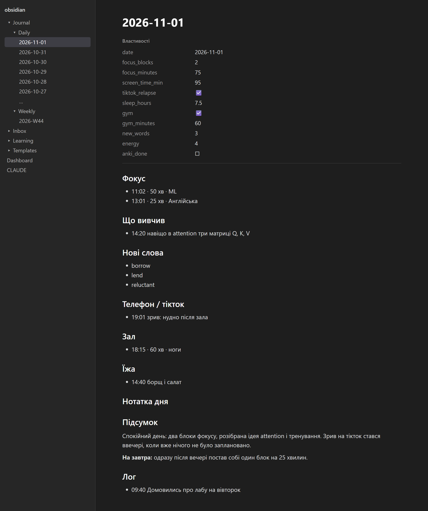
</p>

## 1.3 Що потрібно перед встановленням

| Що | Навіщо | Де взяти |
|---|---|---|
| **Git** | завантажити проєкт і оновлювати його | [git-scm.com](https://git-scm.com); на macOS `xcode-select --install` |
| **uv** | запускає setup і бота, сам завантажує потрібний Python | [docs.astral.sh/uv](https://docs.astral.sh/uv/) |
| **Telegram** | спілкування з ботом | [telegram.org](https://telegram.org) |
| **Obsidian** | щоденник і статистика | [obsidian.md](https://obsidian.md) |
| **Claude Code** | `/journal`, `/weekly`, картки | [code.claude.com](https://code.claude.com) |
| **Anki + AnkiConnect** | картки | [apps.ankiweb.net](https://apps.ankiweb.net), код додатка `2055492159` |

Claude Code і Anki можна поставити пізніше: `setup` тоді пропустить ці кроки й скаже, що зробити, а бот із щоденником уже працюватимуть. Ставити Python окремо не треба, `uv` завантажить його сам.

Обсяг роботи: близько 15 хвилин, якщо нічого з цього ще не встановлено.

## 1.4 Встановлення з нуля

### Крок 1. Git і uv

**Windows** (PowerShell):

```powershell
winget install --id Git.Git -e
powershell -ExecutionPolicy ByPass -c "irm https://astral.sh/uv/install.ps1 | iex"
```

**macOS / Linux:**

```bash
curl -LsSf https://astral.sh/uv/install.sh | sh
```

На macOS Git з'явиться після `xcode-select --install`. Після встановлення відкрий новий термінал, щоб він побачив `uv`.

### Крок 2. Anki і AnkiConnect

1. Встанови [Anki](https://apps.ankiweb.net).
2. В Anki: **Інструменти → Додатки → Отримати додатки**, введи код **`2055492159`**.
3. Перезапусти Anki.
4. Якщо вчиш і на телефоні, увійди в AnkiWeb кнопкою **Синхронізувати**.

Anki має бути відкрита, коли працюєш із картками. Боту вона не потрібна.

### Крок 3. Claude Code

Встанови Claude Code за [інструкцією](https://code.claude.com) і переконайся, що в терміналі працює команда `claude --version`. Вона потрібна, щоб `setup` міг поставити плагін.

### Крок 4. Створи бота

1. Відкрий у Telegram [@BotFather](https://t.me/BotFather) і надішли `/newbot`.
2. Придумай назву, будь-яку.
3. Придумай username, він має закінчуватись на `bot`, наприклад `my_discipline_bot`.
4. BotFather надішле **токен**, схожий на `123456789:AAE…`. Це пароль від бота: нікому його не показуй і не надсилай у чати.

### Крок 5. Дізнайся свій Telegram ID

Відкрий [@userinfobot](https://t.me/userinfobot) і надішли будь-що. Він покаже число, наприклад `123456789`. Бот відповідатиме лише цьому ID.

### Крок 6. Завантаж проєкт

**Windows** (PowerShell):

```powershell
cd $HOME
git clone https://github.com/denysfreiuk/stop-procrastination-with-claude.git discipline
cd discipline
```

**macOS / Linux:**

```bash
cd ~
git clone https://github.com/denysfreiuk/stop-procrastination-with-claude.git discipline
cd discipline
```

> **macOS:** не клади проєкт у Desktop, Documents, Downloads чи iCloud Drive. Система не пускає фонові програми в ці папки, тож бот не запуститься сам. Домашня папка підходить: `~/discipline`.
>
> **Windows:** тримай проєкт у коротшому шляху, наприклад `C:\Users\ім'я\discipline`. Занадто довгий шлях дасть помилку `Filename too long` під час `git clone`.

### Крок 7. Запусти setup

```bash
uv run --python 3.14 setup/setup.py
```

Setup спитає шість речей. Натисни Enter, щоб лишити значення в дужках:

| Запитання | Приклад | Примітка |
|---|---|---|
| Токен бота | `123456789:AAE…` | перевіряється в Telegram одразу |
| Telegram ID | `123456789` | лише цифри |
| Часовий пояс | `Europe/Kyiv` | визначає, у який день потрапить запис |
| Час нагадування | `20:00` | потім можна змінити командою `/remind` |
| Мова пояснень | `uk` | для карток і підсумків |
| Коренева колода Anki | `Study` | під нею з'являться всі колоди плагіна |

Далі він сам зробить усе інше:

<p align="center">
  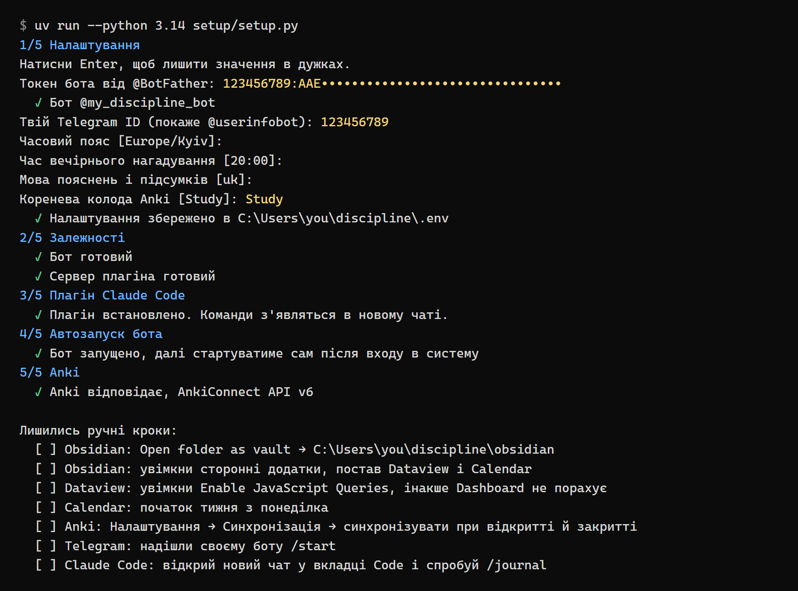
</p>

1. Створить `.env` із твоїми відповідями.
2. Поставить залежності бота і сервера плагіна.
3. Встановить плагін у Claude Code.
4. Запустить бота і налаштує автозапуск: Task Scheduler на Windows, launchd на macOS, systemd на Linux.
5. Перевірить Anki й AnkiConnect і скаже, що робити, якщо їх немає.

Setup можна запускати повторно: він нічого не зламає і запропонує наявні значення.

Додаткові прапорці:

| Прапорець | Що робить |
|---|---|
| `--yes` | нічого не питати, брати значення з наявного `.env` |
| `--no-plugin` | не чіпати плагін Claude Code |
| `--no-autostart` | не налаштовувати автозапуск бота |

### Крок 8. Ручні кроки

Цього setup не може зробити за тебе. В кінці він покаже той самий список.

**Obsidian:**

1. Відкрий Obsidian → **Open folder as vault** → папка `obsidian` у проєкті.
2. Налаштування → **Сторонні додатки** → **Вийти з обмеженого режиму**.
3. **Огляд** → знайди **Dataview** → Встановити → Увімкнути.
4. У налаштуваннях Dataview увімкни **Enable JavaScript Queries**. Без цього Dashboard покаже лише код.
5. **Огляд** → знайди **Calendar** → Встановити → Увімкнути, постав початок тижня з понеділка.

Вбудовані додатки **Daily notes** і **Templates** вмикати не треба: вони вже увімкнені й налаштовані на папки проєкту. Plugin **Obsidian Git** не потрібен, він знадобиться лише для [майбутнього варіанта на сервері](#плани).

**Anki:** Налаштування → Синхронізація → увімкни синхронізацію при відкритті й закритті профілю.

**Telegram:** надішли своєму боту `/start`, з'являться кнопки.

**Claude Code:** відкрий **новий** чат у вкладці **Code** і перевір, що є команда `/journal`. Перший запуск плагіна може зайняти до 30 секунд.

### Крок 9. Перевір, що все працює

1. Надішли боту будь-який текст. Він має з'явитись у розділі `## Лог` сьогоднішньої нотатки.
2. Надішли `/f 25 тест`. У нотатці з'явиться рядок у `## Фокус`.
3. Відкрий `Dashboard.md`: стрік навчання має бути 1.
4. Надішли `/undo` двічі, тестові записи зникнуть.

## 1.5 Telegram-бот

### Усі команди

| Команда | Приклад | Що робить | Куди пише |
|---|---|---|---|
| будь-який текст | `Домовились про лабу` | запис у лог | `## Лог`: `- 09:40 текст` |
| `/f` | `/f 50 ML` | блок фокусу | +1 `focus_blocks`, + хвилини до `focus_minutes`, рядок у `## Фокус` |
| `/l` | `/l як працює PCA` | що вивчив | `## Що вивчив`, `anki_done: false` |
| `/w` | `/w borrow, lend` | нові слова | `## Нові слова`, + до `new_words`, `anki_done: false` |
| `/s` | `/s 95` | час екрана | `screen_time_min` |
| `/tt` | `/tt` або `/tt втома` | зрив на тікток | `tiktok_relapse: true`, причина в `## Телефон / тікток` |
| `/sleep` | `/sleep 7.5` | сон | `sleep_hours` |
| `/gym` | `/gym 60 ноги` | тренування | `gym: true`, + до `gym_minutes`, рядок у `## Зал` |
| `/eat` | `/eat борщ` | їжа, без підрахунку калорій | `## Їжа` |
| `/e` | `/e 4` | енергія дня, 1–5 | `energy` |
| `/n` | `/n гарний день` | нотатка дня | `## Нотатка дня` |
| `/today` | | підсумок дня і що ще не заповнено | нічого не змінює |
| `/streak` | | стріки навчання і без тіктока, тренування за 7 днів | нічого не змінює |
| `/undo` | | скасувати останній запис | див. нижче |
| `/remind` | `/remind 21:30` | час нагадування; без часу покаже поточний | `REMINDER_TIME` у `.env` |
| `/start`, `/help` | | усі команди; `/start` ще й показує кнопки | нічого не змінює |

### Що можна писати в команди

- **Порядок у `/f` і `/gym` неважливий:** `/f 50 ML` і `/f ML 50` одне й те саме. Перше ціле число вважається хвилинами.
- **`/f 25` без теми** бере останню тему.
- **`/w`** розділяє слова комою, крапкою з комою або новим рядком. Те, що вже записано сьогодні, не дублюється.
- **`/s`** розуміє `95`, `1:35`, `1г35`, `1h35`, `2 год`.
- **`/sleep`** розуміє `7.5`, `7,5`, `7:30`.
- **`/s` і `/sleep` перезаписують** значення, а **`/f` і `/gym` додають** до наявного.
- **`/remind`** розуміє `21:30` і `21.30`.

Якщо команду написано з помилкою, бот скаже, як правильно, і нічого не запише.

### Кнопки

Під полем вводу завжди є 12 кнопок. Вони дублюють команди, щоб не набирати нічого руками:

```
🎯 Фокус      📚 Вивчив     🔤 Слова
😴 Сон        📱 Екран      📵 Тікток
🏋️ Зал        🍽 Їжа        🔋 Енергія
📊 Сьогодні   📝 Нотатка    ↩️ Скасувати
```

- **🎯 Фокус** дає вибір 25, 50 чи 90 хвилин, а потім твої останні теми. Це 2 натискання замість команди.
- **😴 Сон** дає готові варіанти від 6 до 8.5 годин, **🔋 Енергія** — від 1 до 5.
- **Решта кнопок** ставлять запитання: наступне повідомлення стане відповіддю.

Те саме працює з командами без тексту: `/l` спитає «Що вивчив?».

### Запитання бота

Якщо бот щось спитав, наступний текст вважається відповіддю, а не записом у лог. Запитання живе **15 хвилин**: пізніше текст іде в лог як зазвичай. Будь-яка команда чи кнопка скасовує відкрите запитання.

### Скасування

`/undo` або **↩️ Скасувати** прибирає останній запис: рядок із розділу й попередні значення Properties. Можна скасовувати далі, історія тримає 20 кроків і переживає перезапуск бота. Записи, які ти зробив в Obsidian вручну, не зачіпаються.

### Вечірнє нагадування

О заданій годині бот пише, що вже записано і чого бракує: фокус, що вивчив, нові слова, екран, сон, їжа, енергія. Якщо все заповнено, напише про це. Зал у «бракує» не входить, бо тренування не щодня.

Час змінюється командою `/remind 21:30` без перезапуску. Якщо о цій годині комп'ютер спав, нагадування прийде, щойно він прокинеться, але лише того самого дня.

### Що варто знати

- Новий день починається опівночі за `TIMEZONE`.
- Запис потрапляє в день і час, коли ти **надіслав** повідомлення, навіть якщо бот отримав його пізніше.
- Кілька рядків в одному повідомленні склеюються в один запис через ` / `.
- Бот записує лише текст. На фото, голосові й стікери він відповідає, що приймає тільки текст.
- Якщо відредагувати вже надіслане повідомлення, запис у нотатці не зміниться.
- Бот відповідає лише твоєму ID і лише в приватному чаті. Усіх інших він повністю ігнорує, навіть не відповідає.

## 1.6 Щоденник в Obsidian

### Папки

```
obsidian/
├── Journal/
│   ├── Daily/        щоденні нотатки, 2026-11-01.md
│   └── Weekly/       тижневі огляди, 2026-W44.md
├── Inbox/            сирі записи, ще не розібрані
├── Learning/         нотатки по темах: ML, English, Uni
├── Templates/        шаблони Daily і Weekly
├── Dashboard.md      статистика
└── CLAUDE.md         правила для Claude Code
```

Нотатку на сьогодні створює бот із першим записом. Можна й вручну: `Ctrl+P` → «щоден» → відкрити сьогоднішню нотатку, або значок календаря зліва. Обидва способи беруть той самий шаблон.

### Щоденна нотатка

Метрики лежать у Properties, тому їх можна рахувати. Порожнє значення означає «не записано», а не нуль.

| Property | Тип | Значення |
|---|---|---|
| `date` | дата | день нотатки |
| `focus_blocks` | число | блоків фокусу |
| `focus_minutes` | число | хвилин фокусу |
| `screen_time_min` | число | час екрана, хвилини |
| `tiktok_relapse` | так/ні | чи був зрив |
| `sleep_hours` | число | сон минулої ночі, години |
| `gym` | так/ні | чи було тренування |
| `gym_minutes` | число | хвилин у залі |
| `new_words` | число | нових слів |
| `energy` | число | енергія дня, 1–5 |
| `anki_done` | так/ні | чи зроблено картки з цієї нотатки |

Розділи: `## Фокус`, `## Що вивчив`, `## Нові слова`, `## Телефон / тікток`, `## Зал`, `## Їжа`, `## Нотатка дня`, `## Підсумок`, `## Лог`.

Нотатку можна спокійно редагувати руками: писати в будь-який розділ, виправляти числа, додавати власні Properties. Бот дописує в кінець розділу й не чіпає решту.

Дві речі, які варто пам'ятати:

- **Не перейменовуй розділи.** Бот і Dashboard шукають їх за точною назвою. Якщо видалити розділ, бот створить його знову в кінці нотатки.
- **Ручні числа додаються до ботових.** Якщо ти поставив `focus_minutes: 50`, а потім бот записав блок на 25, вийде 75.

### Dashboard

<p align="center">
  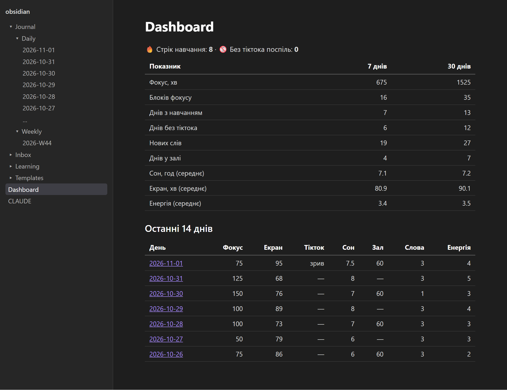
</p>

`Dashboard.md` показує:

- стрік днів із навчанням і стрік днів без тіктока;
- за 7 і 30 днів: хвилини й блоки фокусу, дні з навчанням, дні без тіктока, нові слова, дні в залі, середні сон, екран і енергію;
- таблицю останніх 14 днів із посиланнями на нотатки.

Правила підрахунку однакові всюди: в Dashboard, у `/streak` і в `/weekly`.

- **День навчання** — є хвилини фокусу або запис у `## Що вивчив`.
- **Стрік** — дні поспіль. Порожній сьогоднішній день стрік не обриває, а день без нотатки обриває.
- **Зрив сьогодні** обнуляє стрік днів без тіктока.
- **Середні значення** рахуються лише за дні, де число записане.

### Тижневий огляд

<p align="center">
  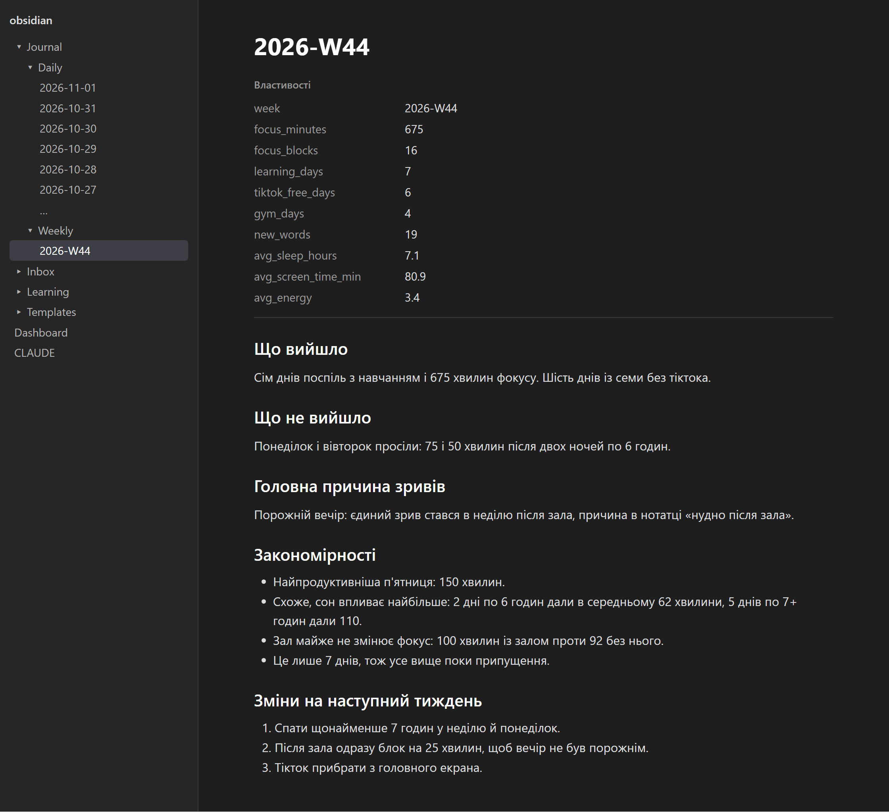
</p>

Створюється командою `/weekly` у `Journal/Weekly/`. Метрики тижня лежать у Properties, нижче: що вийшло, що ні, головна причина зривів, закономірності й зміни на наступний тиждень.

## 1.7 Команди Claude Code

> **Важливо:** ці команди працюють лише в **Claude Code**: у вкладці **Code** застосунку Claude або в терміналі через `claude`. У звичайному чаті й у вкладці Cowork плагіна немає. Якщо там написати `/journal`, Claude не матиме потрібних інструментів.

### `/journal [дата]`

Читає нотатку дня, пише короткий підсумок і 1 конкретну пораду на завтра, дописує їх у `## Підсумок`.

```
/journal
/journal 2026-10-30
/journal вчора
```

Якщо підсумок уже є, Claude покаже його і спитає, чи дописати ще один.

### `/weekly`

Бере 7 останніх нотаток і створює огляд:

- **Метрики** рахує код, а не Claude, тому помилок в арифметиці не буде.
- **Коли ти найпродуктивніший:** дні тижня, час доби, теми.
- **Що передує зривам:** сон, екран, енергія, причини, що було напередодні.
- **Як сон і зал впливають на фокус:** порівняння днів, де ці значення записані.
- **1–3 зміни** на наступний тиждень.

За 7 днів закономірність — це припущення, а не доказ, тож Claude пише «схоже» й вказує кількість днів.

Огляд ніколи не перезаписується: у нього могли потрапити твої власні нотатки. Щоб зробити його заново, спершу видали або перейменуй файл.

### `/anki-from-notes [дата або період]`

Бере `## Що вивчив` і `## Нові слова` з нотаток, де `anki_done` не `true`, і робить картки за всіма правилами плагіна.

```
/anki-from-notes
/anki-from-notes 2026-10-30
/anki-from-notes 2026-10-24..2026-10-30
/anki-from-notes --auto
```

1. Показує превʼю таблицею.
2. Перевіряє дублікати.
3. Після твого «так» додає картки й синхронізує.
4. Лише тоді ставить `anki_done: true`, і лише тим дням, що оброблені повністю.

Якщо запис занадто короткий, наприклад «розібрався PCA», Claude не вигадує зміст, а спитає, що саме закріпити. Новий `/w` чи `/l` повертає `anki_done: false`, а вже додане відсіється як дублікат.

### Що Claude може змінити у щоденнику

Лише три речі: дописати текст у `## Підсумок`, поставити `anki_done: true` і створити новий тижневий огляд. Твої записи він цими інструментами змінити не може.

## 1.8 Картки Anki

Плагін робить картки за принципами інтервальних повторень, активного пригадування і навчання в контексті. Повний опис — у [README плагіна](claude-anki/README.md).

<p>
  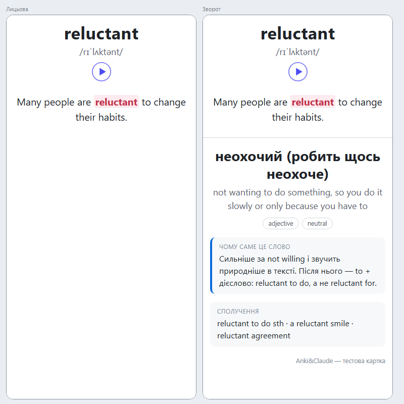
  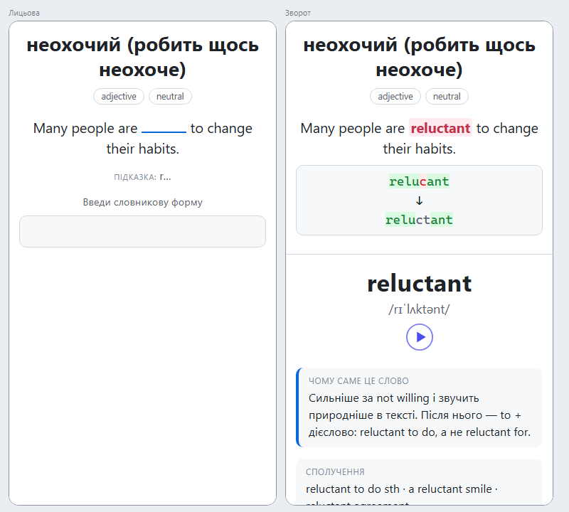
</p>

| Команда | Що робить |
|---|---|
| `/anki-add <текст або тема>` | картки з будь-чого |
| `/anki-file <шлях>` | картки з файлу: PDF лекції, конспект |
| `/anki-vocab <слова або текст>` | англійські слова під твій рівень |
| `/anki-distinct <make/do>` | картки на розрізнення схожих слів |
| `/anki-code <файл або фрагмент>` | картки з коду |
| `/anki-from-notes` | картки зі щоденника |
| `/anki-leeches` | розбір проблемних карток |
| `/anki-stats` | статистика і що підтягнути |
| `/anki-fix <пошук Anki>` | покращення наявних карток |
| `/anki-promote` | розморожування відкладених карток слів |

Синхронізація між пристроями йде через саму Anki й AnkiWeb. Плагін працює лише з AnkiConnect і не звертається до AnkiWeb напряму. Якщо ти саме повторюєш картки, синхронізація відкладається, щоб не заважати.

## 1.9 Налаштування

Усе живе в одному файлі `.env` у корені проєкту. Він не потрапляє в git.

| Поле | За замовчуванням | Що означає |
|---|---|---|
| `TELEGRAM_BOT_TOKEN` | — | токен бота |
| `TELEGRAM_USER_ID` | — | твій ID, бот відповідає лише йому |
| `TIMEZONE` | `Europe/Kyiv` | часовий пояс |
| `REMINDER_TIME` | `20:00` | час вечірнього нагадування |
| `VAULT_PATH` | `obsidian` | шлях до vault: відносний або абсолютний |
| `ANKI_ROOT_DECK` | `Study` | коренева колода |
| `ANKI_CONNECT_URL` | `http://127.0.0.1:8765` | адреса AnkiConnect, тут же порт |
| `ANKI_CONNECT_KEY` | — | лише якщо в AnkiConnect задано `apiKey` |
| `ANKI_EXPLANATION_LANGUAGE` | `uk` | мова карток, підсумків і оглядів |
| `ANKI_ENGLISH_LEVEL` | `B1` | твій рівень англійської |
| `ANKI_ENGLISH_GOAL` | `C1` | ціль |
| `ANKI_EXAMPLE_LEVEL` | `B1-B2` | складність речень-прикладів |
| `ANKI_MAX_CARDS_PER_BATCH` | `15` | максимум карток за раз, 1–50 |
| `ANKI_PROMOTE_AFTER_DAYS` | `3` | через скільки днів інтервалу вмикаються відкладені картки |
| `ANKI_AUTO_SYNC` | `true` | синхронізувати з AnkiWeb після змін |
| `ANKI_TTS` | `true` | озвучка слів |
| `ANKI_TTS_LANG` | `en_US` | `en_US` або `en_GB` |
| `ANKI_REVIEW_REMINDER` | `true` | нагадувати в Claude Code про картки |
| `ANKI_SOUND_ON_STOP` | `false` | звук, коли Claude закінчив відповідь |

Денні ліміти нових карток живуть у самій Anki: їх змінює команда на кшталт «постав UA-EN 5 на день».

### Коли зміни набувають чинності

| Що змінив | Що зробити |
|---|---|
| час через `/remind` | нічого, діє одразу |
| `ANKI_*` | відкрити новий чат Claude Code |
| решту в `.env` | перезапустити бота |

Перезапуск бота:

**Windows** (PowerShell):

```powershell
schtasks /End /TN StopProcrastinationBot
schtasks /Run /TN StopProcrastinationBot
```

**macOS:**

```bash
launchctl kickstart -k gui/$(id -u)/com.stop-procrastination.bot
```

**Linux:**

```bash
systemctl --user restart stop-procrastination-bot
```

Простіший спосіб на будь-якій системі:

```bash
uv run --python 3.14 setup/setup.py --yes --no-plugin
```

## 1.10 Оновлення і видалення

### Оновлення

```bash
uv run --python 3.14 setup/setup.py update
```

Команда робить `git pull`, додає в `.env` нові поля з коментарями, оновлює залежності й плагін, перезапускає бота. Твої значення в `.env`, нотатки й дані бота не змінюються. Нові команди Claude Code з'являться в новому чаті.

Якщо ти змінив файл, що лежить у git, наприклад `Dashboard.md` чи шаблон, `update` зупиниться і покаже який. Тоді збережи зміни через `git stash` або скасуй їх через `git restore <файл>` і запусти ще раз.

### Видалення

```bash
uv run --python 3.14 setup/setup.py uninstall
```

Зупиняє бота, прибирає автозапуск і плагін. Спершу спитає підтвердження. Твої нотатки, `.env` і дані бота лишаються на місці: щоб прибрати все, видали папку проєкту вручну, попередньо зберігши нотатки.

## 1.11 Що буде, якщо комп'ютер вимкнений

Бот живе на твоєму комп'ютері. Коли він вимкнений або спить, повідомлення чекають на серверах Telegram, але [не довше 24 годин](https://core.telegram.org/bots/api#getting-updates).

| Скільки комп'ютер вимкнений | Що буде |
|---|---|
| до 24 годин | усе, що ти написав, запишеться після ввімкнення. Час і день будуть правильні: ті, коли ти надсилав |
| понад 24 години | повідомлення, старші за 24 години, пропадуть |

Тому:

- Сон ноутбука не страшний, якщо він не довший за добу: бот сам підключиться після пробудження.
- Якщо їдеш кудись без комп'ютера надовго, тримай записи в чаті: вони лишаться там, і їх можна переслати боту пізніше. Час запису тоді буде часом пересилання.
- Вечірнє нагадування приходить лише тоді, коли комп'ютер увімкнений. Пропущене ввечері нагадування наступного дня вже не прийде.
- Щоб не залежати від комп'ютера взагалі, потрібен [варіант на сервері](#плани), він у планах.

## 1.12 Типові проблеми

Спершу подивись лог бота: `telegram-bot/data/bot.log`.

### Бот

**Бот не відповідає.**

1. Перевір, що він запущений:
   - Windows: `Get-ScheduledTask StopProcrastinationBot` має показати `Running`
   - macOS: `launchctl print gui/$(id -u)/com.stop-procrastination.bot`
   - Linux: `systemctl --user status stop-procrastination-bot`
2. Перевір `.env`: `TELEGRAM_BOT_TOKEN` без пробілів і лапок, правильний `TELEGRAM_USER_ID`. Бот мовчки ігнорує всі інші ID.
3. Запусти бота вручну й подивись на помилку:

   ```bash
   uv run --no-project --directory telegram-bot --python 3.14 python launch.py --check
   ```

**У лозі `Conflict: terminated by other getUpdates request`.** Той самий токен працює у двох місцях. Telegram дозволяє лише одну копію бота на токен. Зупини зайву: наприклад, ручний запуск поруч з автозапуском.

**У лозі `Telegram is unreachable`.** Немає інтернету. Це нормально для ноутбука, бот сам підключиться знову.

**Токен потрапив кудись не туди.** Надішли [@BotFather](https://t.me/BotFather) `/revoke`, впиши новий токен у `.env` і перезапусти бота.

**Запис не з'явився в нотатці, бот написав «Не вдалося записати».** Файл не вдалося змінити, наприклад його тримає інша програма. Повідомлення лишилось у чаті, надішли його ще раз.

**Obsidian показує «modified externally».** Ти редагував нотатку в той самий момент, коли бот у неї писав. Obsidian зливає зміни сам, а бот через кілька секунд перевіряє свій запис і за потреби повертає його.

### Obsidian

**Dashboard показує код замість таблиць.** Не встановлено Dataview або не ввімкнено **Enable JavaScript Queries**.

**Нова нотатка створюється не в `Journal/Daily` або без шаблону.** Перевір: Налаштування → Daily notes → папка `Journal/Daily`, шаблон `Templates/Daily`.

**Число в Properties не збігається з розділом.** Перевір, чи не ставив ти його вручну: ботові хвилини додаються до наявного значення.

### Claude Code

**Команд `/journal`, `/weekly` немає.**

1. Перевір, що ти у вкладці **Code** або в терміналі `claude`, а не в звичайному чаті чи Cowork.
2. Відкрий **новий** чат: відкриті чати працюють зі старою версією.
3. Перевір, що плагін встановлено: `claude plugin list`.
4. Повністю закрий застосунок Claude і відкрий знову.

**«Не задано шлях до vault».** Плагін не бачить `.env`. Запусти `setup` ще раз.

**«Огляд уже є».** Тижневий огляд не перезаписується. Видали або перейменуй файл у `Journal/Weekly/`.

### Anki

**«Anki не відповідає».** Відкрий Anki. Перевір, що встановлено AnkiConnect (код `2055492159`) і Anki перезапущена.

**Вікно з помилкою озвучки, інші проблеми Anki.** Див. [усунення проблем плагіна](claude-anki/README.md#усунення-проблем).

### Windows

**`Filename too long` під час `git clone`.** Шлях занадто довгий: клонуй ближче до кореня, наприклад у `C:\Users\ім'я\discipline`.

**«An Application Control policy has blocked this file».** Це Smart App Control. Бот і плагін для того й запускаються без віртуального середовища. Якщо блокується сам `uv.exe`, перевстанови uv офіційним інсталятором.

**Кирилиця в консолі виглядає кракозябрами.** Це лише відображення, файли завжди в UTF-8. У PowerShell допоможе `chcp 65001`.

### macOS

**Бот не стартує сам, у `telegram-bot/data/launchd.log` є `Operation not permitted`.** Проєкт лежить у захищеній папці. Перенеси його в `~/discipline`, запусти `setup` знову.

**Плагін інколи не достукається до Anki.** Вимкни App Nap і перезапусти Anki:

```bash
defaults write net.ankiweb.dtop NSAppSleepDisabled -bool true
```

## 1.13 Приватність і резервні копії

**Що лишається тільки на твоєму комп'ютері:** нотатки, `.env`, токен, дані й логи бота. У публічний репозиторій потрапляє лише шаблон vault: папки, шаблони, Dashboard, `CLAUDE.md` і кілька налаштувань Obsidian.

**Що кудись передається:**

- Текст твоїх повідомлень боту проходить через Telegram.
- Коли ти запускаєш `/journal`, `/weekly` чи `/anki-from-notes`, Claude читає відповідні нотатки.
- Картки синхронізуються через AnkiWeb, якщо ти ввімкнув синхронізацію.

**Захист від випадкового коміту:** перевірка перед кожним комітом блокує особисті нотатки, `.env`, дані бота, токени й твій Telegram ID. Вмикає її `setup`.

> **Важливо про резервні копії.** Оскільки нотатки не лежать у git, ніхто, крім тебе, їх не збереже. Якщо диск вийде з ладу, щоденник пропаде. Налаштуй копію папки `obsidian/`: Obsidian Sync, хмарне сховище або власний **приватний** репозиторій. Вбудований додаток **Відновлення файлів** допоможе лише з випадковими змінами.

---

# Частина 2. Як це влаштовано

## 2.1 Архітектура

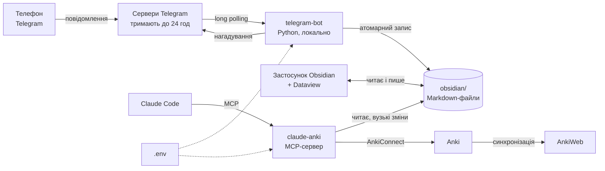

Частини не знають одна про одну й не мають спільного коду. Їхній контракт — це файли: формат нотатки й `.env`. Звідси три властивості:

- **Markdown — єдине джерело правди.** База даних не потрібна: усе можна прочитати й виправити руками.
- **Кожна частина працює сама.** Бот не потребує Claude, плагін не потребує бота, Obsidian не потребує ні того, ні іншого.
- **Немає власного сервера.** Telegram і так зберігає повідомлення, а бот забирає їх long polling'ом, тож вхідні порти відкривати не треба.

## 2.2 Структура репозиторію

```
.
├── .claude-plugin/marketplace.json   маркетплейс Claude Code → claude-anki/plugins/ankiclaude
├── .githooks/pre-commit              перевірка приватності перед комітом
├── .github/workflows/ci.yml          CI: 14 джобів на трьох ОС
├── .env.example                      приклад конфігу з коментарями
├── .gitignore                        білий список для vault
├── docs/screenshots/                 зображення цього README
│
├── obsidian/                         шаблон vault
│   ├── .obsidian/                    daily-notes.json, templates.json, types.json
│   ├── Templates/                    Daily.md, Weekly.md
│   ├── Dashboard.md                  статистика на DataviewJS
│   └── CLAUDE.md                     правила для Claude Code
│
├── telegram-bot/
│   ├── launch.py                     запуск без venv
│   ├── pyproject.toml, uv.lock       залежності
│   ├── requirements.lock.txt         точні версії з хешами для launch.py
│   ├── data/                         не в git: залежності, state.json, bot.log
│   ├── src/discipline_bot/
│   │   ├── bot.py                    Telegram: хендлери, кнопки, фоновий цикл
│   │   ├── assistant.py              логіка розмови, без Telegram
│   │   ├── commands.py               розбір аргументів команд
│   │   ├── journal.py                нотатки на диску, шаблон, undo
│   │   ├── markdown.py               зміни тексту нотатки по рядках
│   │   ├── stats.py                  підсумок дня, стріки, нагадування
│   │   ├── config.py                 читання і зміна .env
│   │   └── files.py                  атомарний запис
│   └── tests/
│
├── claude-anki/                      плагін Anki&Claude, з git-історією
│   ├── README.md                     докладно про картки
│   ├── docs/                         PLAN.md, скріншоти карток
│   ├── tests/js/                     тести JS шаблонів карток
│   ├── tools/preview.py              галерея карток з живої Anki
│   └── plugins/ankiclaude/
│       ├── .claude-plugin/plugin.json   маніфест, userConfig
│       ├── .mcp.json                 запуск MCP-сервера
│       ├── hooks/hooks.json          SessionStart, Stop
│       ├── skills/                   anki-cards і 12 slash-команд
│       └── server/                   MCP-сервер
│           ├── launch.py, hook.py
│           ├── src/anki_claude/      AnkiConnect, колоди, нотатки, journal.py
│           └── tests/
│
└── setup/
    ├── setup.py                      install, update, uninstall
    ├── autostart.py                  Task Scheduler, launchd, systemd
    ├── check_privacy.py              перевірка приватності
    └── tests/
```

## 2.3 Єдиний конфіг

Один `.env` читають усі частини, але кожна по-своєму.

| Частина | Як знаходить `.env` | Що бере |
|---|---|---|
| бот | `ROOT/.env` або `DISCIPLINE_ENV_FILE` | `TELEGRAM_*`, `TIMEZONE`, `REMINDER_TIME`, `VAULT_PATH` |
| плагін | опція `env_file` з `userConfig` → `ANKI_CLAUDE_ENV_FILE` | `ANKI_*`, `VAULT_PATH`, `TIMEZONE` |
| хуки плагіна | `CLAUDE_PLUGIN_OPTION_ENV_FILE` | `ANKI_*` |
| `check_privacy.py` | `ROOT/.env` | значення, яких не має бути в git |

**Чому не просто змінні середовища.** Плагін встановлюється окремо від репозиторію й не знає, де той лежить. Setup передає шлях при встановленні: `claude plugin install … --config env_file=<шлях>`.

**Пріоритет.** Claude Code передає у змінні середовища значення `userConfig` разом із їхніми стандартними значеннями, і в звичайному порядку вони завжди б перекривали файл. Тому в `config.py`:

| Ситуація | Порядок |
|---|---|
| задано `ANKI_CLAUDE_ENV_FILE` | файл → змінні середовища → стандартні значення |
| файл знайдено в теці користувача | змінні середовища → файл → стандартні значення |

Порожній рядок у файлі не стирає значення, а пропускається. Плагін лишається самостійним: без `.env` він працює на `userConfig`, як звичайний плагін. Команди щоденника тоді скажуть, що не задано `VAULT_PATH`.

`/remind` змінює `REMINDER_TIME` у самому `.env`, по одному рядку, зберігаючи коментарі й кінці рядків.

## 2.4 Бот зсередини

### Шари

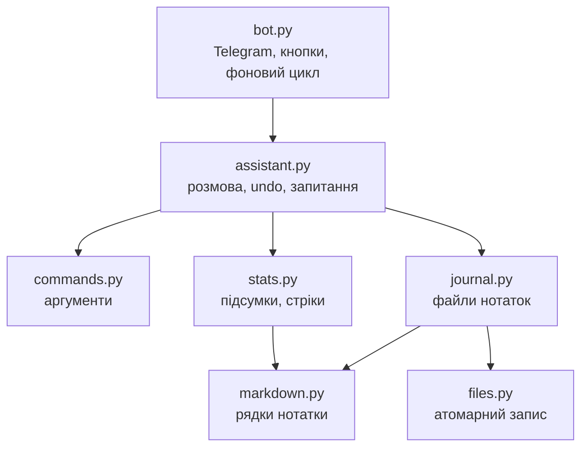

`assistant.py` не знає про Telegram: він приймає текст і час, а повертає `Reply(text, buttons)`. Тому майже всю логіку можна перевіряти без мережі, а `bot.py` лишається тонким шаром на 200 рядків.

### Шлях повідомлення

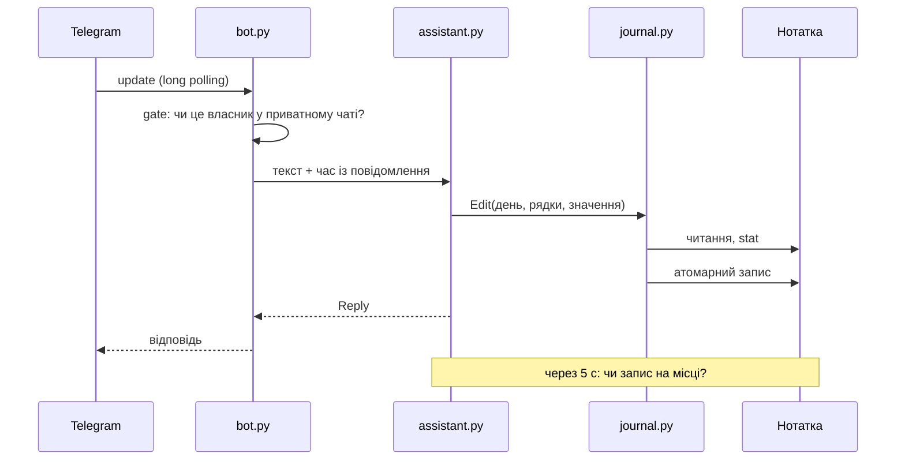

### Безпека

Перший обробник стоїть у групі `-1`, тобто раніше за всі інші. Якщо оновлення не від власника або не з приватного чату, він кидає `ApplicationHandlerStop`, і далі воно не йде. Перевірка одна на все: команди, текст і натискання кнопок. Тести проганяють це через справжній конвеєр `python-telegram-bot` із фейковим сервером Telegram.

`httpx` пише URL кожного запиту в лог на рівні INFO, а в URL Telegram є токен. Тому логери `httpx` і `httpcore` підняті до WARNING. Тексти повідомлень у лог не потрапляють.

### Запис у нотатку

Головна вимога: не втрачати дані, навіть коли файл відкритий в Obsidian. Захист має чотири рівні.

1. **Зміни по рядках.** Frontmatter не розбирається і не збирається назад як YAML: міняється лише рядок потрібного ключа. Тому чужі Properties, коментарі й порядок лишаються байт у байт.
2. **Оптимістичне блокування.** `_update` запам'ятовує `mtime` і розмір перед читанням і перевіряє їх перед записом. Якщо файл змінився, усе починається спочатку з новим текстом, до 5 спроб.
3. **Атомарний запис.** Текст іде в тимчасовий файл `.ім'я.pid.tmp`, робиться `fsync`, потім `os.replace`. Читач ніколи не побачить половину нотатки. Крапка спереду ховає файл від Obsidian. На Windows `os.replace` падає, поки файл тримає інша програма, тому є повтори з паузою.
4. **Перевірка після запису.** Obsidian може зберегти свою старішу копію поверх нашого запису, якщо ти саме друкуєш. Через 5 секунд `confirm_writes` перевіряє, чи запис на місці, і повертає втрачене. Якщо зник увесь запис, повертаються й числа. Якщо зникла лише частина рядків, числа не чіпаються, щоб не порахувати двічі.

Новіше значення того самого ключа не вважається втратою: `/s 95`, а за 2 секунди `/s 120` не поверне 95. `/undo` теж знімає запис з перевірки.

Кожен запис — рівно один рядок. Це спрощує все інше: пошук у розділі, скасування, перевірку, статистику.

### Шаблон

Бот і Obsidian користуються тим самим `Templates/Daily.md`. Бот підставляє `{{date:…}}`, `{{time:…}}` і `{{title}}`. Лапки навколо змінної в шаблоні потрібні лише для редактора Properties в Obsidian, тому під час підстановки вони знімаються. Нотатка створюється ексклюзивно (`open("xb")`): якщо Obsidian щойно зробив свою, вона лишається. Якщо шаблон видалено, бот усе одно запише: відсутні ключі й розділи додаються на вимогу.

### Стан

`data/state.json`: останні теми, історія `/undo` (20 кроків) і день останнього нагадування. Відкрите запитання тримається лише в пам'яті: після перезапуску відповідь просто піде в лог, нічого не втратиться.

### Фоновий цикл

Один цикл кожні 5 секунд робить дві речі: перевіряє останні записи і час нагадування. Нагадування порівнюється умовою «час настав і сьогодні ще не надсилали», а не точним збігом часу, тому переживає сон ноутбука. День позначається надісланим лише після успішної відправки.

### Запуск

`launch.py` обходиться стандартною бібліотекою. Він один раз ставить залежності з `requirements.lock.txt` (`--require-hashes`) через `uv pip install --target` у `data/pydeps-<версія>-<хеш>`, додає їх у `sys.path` і запускає бота. `run_polling(bootstrap_retries=-1)` дає боту дочекатись мережі після входу в систему, а `drop_pending_updates=False` забирає те, що накопичилось, поки комп'ютер був вимкнений.

## 2.5 Плагін Claude Code

Докладно про картки: [README плагіна](claude-anki/README.md) і [журнал рішень](claude-anki/docs/PLAN.md). Плагін перенесено з окремого репозиторію через `git subtree`, тож його історія збереглась.

Що додано для щоденника:

| MCP-інструмент | Тип | Що робить |
|---|---|---|
| `read_journal` | читання | нотатки за період, останні N чи необроблені для Anki, з метриками |
| `add_day_summary` | запис | дописує в кінець `## Підсумок` |
| `mark_anki_done` | запис | ставить `anki_done: true` |
| `save_weekly_review` | запис | створює огляд, метрики рахує сам |

**Чому вузькі інструменти, а не Edit.** Скіли могли б редагувати файли звичайними інструментами Claude, але тоді правило «не переписувати записи користувача» трималось би лише на тексті інструкції. Тут воно в коді: іншого способу змінити нотатку ці інструменти не мають. Заодно не потрібні запити дозволу на файли поза проєктом, а запис такий самий атомарний, як у бота.

**Чому метрики в коді.** Модель може помилитись в арифметиці. `read_journal` повертає готові `totals`, а `save_weekly_review` перераховує їх сам, тож у Properties огляду потрапляє те, що порахував код.

Всього в плагіна 24 MCP-інструменти, 13 скілів і 2 хуки: `SessionStart` розморожує відкладені картки, `Stop` нагадує про повторення.

Плагін не може імпортувати код бота: він встановлюється окремо від репозиторію. Тому рядкові функції в `anki_claude/journal.py` — це копія з `discipline_bot/markdown.py`. Формат тримають разом тести на справжньому шаблоні з `obsidian/Templates`.

## 2.6 Шаблон vault і статистика

У git лежать три файли налаштувань Obsidian:

| Файл | Що задає |
|---|---|
| `daily-notes.json` | папка, формат назви і шаблон щоденних нотаток |
| `templates.json` | папка шаблонів і формат дати |
| `types.json` | типи Properties, щоб порожнє `screen_time_min:` було числом, а не текстом |

Решту, зокрема `workspace.json`, Obsidian створює сам, і вона в git не потрапляє. Daily notes і Templates в Obsidian увімкнені за замовчуванням, тому після клонування вони одразу налаштовані.

`Dashboard.md` — один блок DataviewJS. Він читає `Journal/Daily`, будує мапу «дата → нотатка» і рахує все сам. Розділи бере через `file.lists` і поле `section`.

Правила статистики реалізовані тричі: `Dashboard.md`, `stats.py` бота і `journal.py` плагіна. Кожна копія живе в іншому середовищі (браузерний JS у Dataview, бот, плагін), а тому спільного коду тут бути не може. Правила описані в `obsidian/CLAUDE.md`.

## 2.7 Setup і автозапуск

`setup.py` навмисно використовує лише стандартну бібліотеку і запускається через `uv run --python 3.14`, без inline-метаданих: вони змусили б uv створити venv.

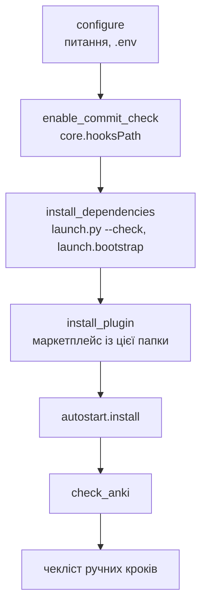

Плагін ставиться з локальної папки, а не з GitHub. Так його версія завжди збігається з рештою проєкту, а `readFromFolder` означає, що кеш не застаріває. Якщо папку перенесли, маркетплейс перестворюється з новим шляхом.

| ОС | Механізм | Що запускає | Деталі |
|---|---|---|---|
| Windows | Task Scheduler, `LogonTrigger` | `pythonw.exe launch.py` | XML у UTF-16, працює без прав адміністратора |
| macOS | launchd, `~/Library/LaunchAgents` | `uv run … launch.py` | `RunAtLoad`, `KeepAlive`, `ThrottleInterval 30` |
| Linux | systemd user service | `uv run … launch.py` | `Restart=always`; щоб працювало без входу: `loginctl enable-linger` |

**Деталі Windows.** Стандартне завдання Task Scheduler зупиняється через 3 дні й при переході на батарею. Тому в XML явно стоять `ExecutionTimeLimit=PT0S`, `DisallowStartIfOnBatteries=false` і `StopIfGoingOnBatteries=false`. `MultipleInstancesPolicy=IgnoreNew` не дає запустити другу копію, а `RestartOnFailure` піднімає бота після збою.

**Чому `pythonw`, а не `uv run`.** На Windows `uv run` дав би дерево з кількох процесів, а `schtasks /End` міг би лишити дочірній живим, і тоді другий запуск отримав би конфлікт за токен. `pythonw` — один процес без вікна консолі.

**Smart App Control.** На Windows 11 він блокує непідписані `.exe`, зокрема лаунчери у venv. Тому і бот, і плагін не покладаються на venv: залежності лежать папкою, а запускає їх базовий Python. Бот до того ж зовсім без скомпільованих залежностей: усі 9 пакетів написані на чистому Python.

**Update** перезапускає себе після `git pull` (`--after-pull`), щоб далі працював уже новий код setup.

## 2.8 Захист приватності в git

Захист тришаровий:

1. **`.gitignore` як білий список.** Для `obsidian/` усе заборонено, а дозволено перелік файлів. Нова папка з нотатками автоматично лишиться приватною.
2. **`check_privacy.py` у pre-commit.** Шлях перевіряється за тим самим списком, тому `git add -f` не допоможе. Вміст шукає формати токенів Telegram, GitHub, Anthropic і приватних ключів, а також конкретні значення цієї машини: токен і ID з `.env` та особистий email із глобального git.
3. **Той самий скрипт у CI** як окремий джоб, бо хук на машині можна обійти.

Перевірка всього, що лежить у git:

```bash
uv run --no-project --python 3.14 python setup/check_privacy.py --all
```

## 2.9 Тести і CI

| Набір | Де | Скільки | Що перевіряє |
|---|---|---|---|
| Плагін | `claude-anki/plugins/ankiclaude/server/tests` | 164 | фейковий AnkiConnect, журнал на тимчасовому vault |
| Шаблони карток | `claude-anki/tests/js` | 14 | JS шаблонів у jsdom |
| Бот | `telegram-bot/tests` | 163 | парсинг, запис у markdown, сценарії розмови, справжній конвеєр Telegram із фейковим сервером |
| Setup | `setup/tests` | 33 | `.env`, плагін, автозапуск, приватність |

Запуск:

```bash
cd telegram-bot && uv run python -m pytest
```

```bash
cd claude-anki/plugins/ankiclaude/server && uv run python -m pytest
```

```bash
cd claude-anki/tests/js && npm ci && npm test
```

```bash
uv run --no-project --python 3.14 python -m unittest discover -s setup/tests
```

Тести не потребують ні Telegram, ні Anki, ні справжнього vault. Важливі сценарії: чужий користувач нічого не отримує, запис із Obsidian під час нашого запису не губиться, втрачений запис повертається один раз, токен не потрапляє в лог, шаблон містить усе, що пише бот.

CI запускає 14 джобів на кожен push:

| Джоб | Матриця |
|---|---|
| `python` | плагін: Python 3.12 і 3.14, Linux, Windows, macOS |
| `bot` | бот: те саме, плюс запуск `launch.py` |
| `setup` | Linux, Windows, macOS: тести і встановлення з нуля |
| `templates-js` | JS шаблонів |
| `manifests` | `claude plugin validate` |
| `privacy` | особисті дані й секрети |

Обидва Python-джоби також перевіряють, що `requirements.lock.txt` збігається з `uv.lock`.

## 2.10 Рішення і чому саме так

| Рішення | Альтернатива | Чому так |
|---|---|---|
| python-telegram-bot | aiogram | залежність лише `httpx`, без скомпільованих файлів, тож Smart App Control нема що блокувати; aiogram обмежений Python < 3.15 |
| Long polling | webhook | не потрібні сервер, домен і відкриті порти |
| Markdown як сховище | SQLite | дані читаються й правляться руками, Obsidian працює з ними напряму |
| Зміни frontmatter по рядках | YAML round-trip | не переформатовує чужі Properties |
| Dataview | Obsidian Bases | Bases рахує суми, але не стріки між днями |
| Новий день о 00:00 | день о 04:00 | простіше: без окремого налаштування |
| Запис без черги на диску | журнал подій | якщо запис не вдався, бот каже про це, а повідомлення лишається в чаті |
| Лише українська в боті | багатомовність | простота важливіша; мову карток і підсумків можна змінити |
| Плагін із локальної папки | з GitHub | версія збігається з репозиторієм |
| `git subtree` для плагіна | копіювання | збереглась історія комітів |
| Без прямого доступу до AnkiWeb | своя синхронізація | умови AnkiWeb забороняють сторонні клієнти, тож лише AnkiConnect |
| Вбудована перевірка, а не `pre-commit` | фреймворк | менше залежностей: достатньо `uv` |

## 2.11 Як розвивати проєкт

**Запустити бота вручну для розробки.** Спершу зупини автозапуск, інакше буде конфлікт за токен:

```bash
uv run --no-project --directory telegram-bot --python 3.14 python launch.py
```

**Додати команду боту:**

1. Метод у `assistant.py` із сигнатурою `(args, now) -> Reply`.
2. Рядок у `handlers` і `COMMANDS` у `bot.py`. Тест перевіряє, що вони збігаються.
3. За потреби кнопка: `BUTTON_ROWS` і `self.buttons` в `assistant.py`.
4. Тест у `tests/test_assistant.py`.

**Додати метрику:** шаблон `Templates/Daily.md`, `types.json`, `Dashboard.md`, `obsidian/CLAUDE.md`, `stats.py` бота, `journal.py` плагіна.

**Випустити версію плагіна.** Версія живе в трьох місцях: `plugin.json`, `pyproject.toml`, `__init__.py`. Після зміни виконай у `server/`:

```bash
uv lock
```

```bash
uv export --no-dev --no-emit-project --no-header --format requirements-txt -o requirements.lock.txt
```

**Формат комітів:** коротка англійська назва в наказовому способі, пояснення «чому» в тілі.

---

# Статус платформ

| | Windows | macOS | Linux |
|---|---|---|---|
| Тести в CI | так | так | так |
| Встановлення з нуля в CI (без плагіна й автозапуску) | так | так | так |
| Встановлення з плагіном на живій машині | так | ще ні | ще ні |
| Автозапуск на живій машині | так | ще ні | ще ні |

Windows перевірено на реальному комп'ютері. Для macOS і Linux код є і перевірений автоматично, але перший справжній запуск автозапуску ще попереду. Якщо щось не спрацює, створи [issue](https://github.com/denysfreiuk/stop-procrastination-with-claude/issues).

# Плани

**Бот на сервері.** Зараз бот залежить від увімкненого комп'ютера. Варіант на майбутнє: бот на невеликому VPS пише у vault, який синхронізується через приватний git-репозиторій і плагін Obsidian Git. Тоді повідомлення не губитимуться, а нагадування приходитимуть завжди. Для цього бот уже має все потрібне: він читає шлях до vault із `VAULT_PATH` і не залежить від Obsidian. Це план, а не готова функція.

# Ліцензія

[MIT](LICENSE). Плагін містить вбудовані бібліотеки [highlight.js](https://highlightjs.org) (BSD-3-Clause) і [Anki-Persistence](https://github.com/SimonLammer/anki-persistence) (MIT).

Поставити лише плагін для карток, без бота й щоденника:

```
/plugin install ankiclaude --marketplace denysfreiuk/stop-procrastination-with-claude
```
